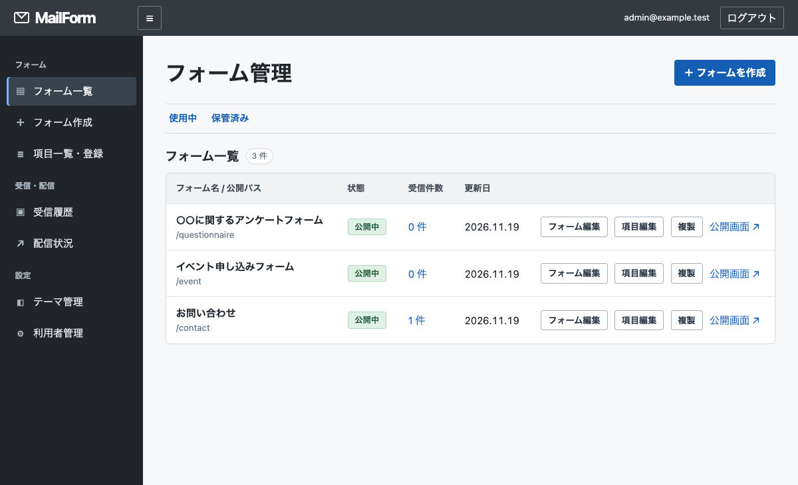

# MailForm

EasyMail 2.00.124・2.00.125・2.00.133・2.01.004のフォームを引き継いで、自分のサーバーで問い合わせ・申込・アンケートを受け付けるための日本語メールフォームCMSです。既存フォームの公開URL・項目順・通知設定の移行と、新規フォームの作成に対応します。EasyMailとは独立したプロジェクトです。

## 旧EasyMailから移行する方へ

1. **旧サイトの管理画面とバージョンを確認する。** 管理入口は「EasyMailの設置URL＋`/admin`」です。たとえば `/contact/` に設置し、申込フォームが `/contact/recruit` なら、管理入口は `/contact/admin` です。ログイン後、管理トップの製品名の横に版番号があります。旧PHPが動かないときは設置ファイルをテキストで確認できます。[旧サイトの確認手順](docs/EASYMAIL-VERSION.md)
2. **新サーバーを1台用意する。** AlmaLinux 10.3 Minimal にSSHで入り、設置スクリプトを実行します。PHP・MariaDB・nginxが設定され、管理画面を手元のPCから開けます。[AlmaLinux 10.3 の簡単設置と移行](docs/ALMALINUX10.md)
3. **現行URLで練習し、受付を引き継ぐ。** 旧版が実際の申込を受けている間に、別DBで取込・画面・メールを検証します。短い受付停止中に最終コピーを取り込み、受付件数・添付を照合してから同じURLの接続先を切り替えます。[並行稼働・切替・切り戻し](docs/CUTOVER.md)・[URLの照合](docs/URLS.md)・[DBと添付の取込](docs/IMPORT.md)



## 管理画面でできること

| 用途 | 操作 |
| --- | --- |
| フォームを追加 | お問い合わせ・イベント申し込み・アンケートをひな型に作成。既存フォームも複製できます。標準40項目や自分で登録した共通項目から必要なものを選びます。 |
| 入力を設定 | 必須、文字種・文字数、再入力の照合、選択肢、日付・時刻、姓名・ふりがな、住所、ファイル添付。郵便番号からの住所補完は同梱データを使います。 |
| デザインを変更 | 5種類の標準レイアウト。項目の順序、説明、各画面のメッセージ、ヘッダー・フッターを変更できます。編集中の内容は下書きとして保存し、公開時に版を記録します。 |
| 受け付ける | 入力・確認・修正・完了。受付と管理者通知・自動返信の送信待ちデータを一緒に保存します。SMTPの配信結果は管理画面から確認できます。 |
| 履歴を利用 | フォーム別の履歴、添付取得、Excel用CSV。受付時の定義を保持し、後日項目を変更しても古い回答を表示できます。 |
| 移行する | 旧DBのバックアップを読み取り、フォーム・共通項目・履歴・添付を取り込みます。事前診断と再実行に対応します。 |

公開フォームの標準グレーテーマは[画面例](docs/images/contact.png)で確認できます。日本語・英語・簡体字の表示に対応し、項目名や案内文はフォームごとに設定できます。

詳しい操作は[管理画面の使い方](docs/ADMIN.md)、対応範囲と差異は[移行手順](docs/IMPORT.md)を参照してください。独自テーマのPHP・Blade・JavaScript、旧プラグインは実行しません。標準デザインは現在のブラウザー向けに再構成しており、独自デザインと入力条件は切替前に照合してください。

## 設置

PHP 8.4 / 8.5、Composer 2、MariaDB 11.4 / 11.8またはMySQL 8.4、SMTPサーバー、毎分のcronまたはsystemdタイマーを用意します。PHPにはLaravelの標準拡張に加え、PDO MySQL、mbstring、DOM、fileinfoを有効にします。Node.jsは不要です。

1. 空のDBと、このDBを利用できるユーザーを作成します。文字コードは `utf8mb4` を使用してください。
2. このリポジトリを取得し、プロジェクト直下で以下を実行します。Webサーバーの公開ディレクトリは **`public/`** に設定します。`storage/` と `bootstrap/cache/` はPHPの実行ユーザーが書き込めるようにします。
3. `.env` に公開URL、DBとSMTPの接続情報、送信元アドレスを設定します。MariaDBは `DB_CONNECTION=mariadb`、MySQLは `DB_CONNECTION=mysql` を指定します。本番はHTTPSを使い、`APP_DEBUG=false`、`SESSION_SECURE_COOKIE=true` とします。

```sh
composer install --no-dev --prefer-dist --optimize-autoloader
cp .env.example .env
php artisan key:generate
```

接続情報を設定したら、以下を実行します。管理者のパスワードは対話入力します。

```sh
php artisan migrate --force
php artisan mailform:admin admin@example.com
php artisan mailform:check --smtp
```

管理画面は `/admin` です。サブディレクトリに設置する場合は例として `https://example.com/contact-form` を `APP_URL` に設定し、そのパスを本アプリの `public/` に割り当てます。管理画面は `/contact-form/admin` になります。

cronの例では、PHP実行ファイルと設置先を実環境のパスに置き換えてください。

```cron
* * * * * cd /path/to/MailForm && /path/to/php artisan schedule:run >> /dev/null 2>&1
```

`mailform:check` で定期実行の記録を確認できます。送信待ちメールを手動処理する場合は `php artisan mailform:deliver` を実行します。送信結果が「結果不明」の場合はSMTP側の記録を確認し、`php artisan mailform:resolve 配信ID sent` または `php artisan mailform:resolve 配信ID retry` で処理します。

## 既存フォームの移行

旧DBを別の検証用DBに復元し、`.env` の `LEGACY_DB_*` に読み取り専用の接続情報を設定します。旧版の設置ファイルはWeb公開領域の外に置きます。履歴CSVだけではフォームの入力条件や通知設定を復元できません。

```sh
php artisan easymail:import --source-root=/path/to/EasyMail --dry-run
php artisan easymail:import --source-root=/path/to/EasyMail --form=1
php artisan easymail:import --verify-only --source-root=/path/to/EasyMail --form=1
```

同じ旧フォームIDからの再実行は移行済みデータを識別します。移行中は元データを正とし、新版での編集・公開を始める前に最終取込を終えてください。取り込んだ履歴から過去のメールを再送することはありません。[移行手順と公開判定](docs/IMPORT.md)

## セキュリティと保守

- 管理画面はログイン必須です。管理者・編集者・閲覧者のいずれも保存対象の回答を閲覧できるため、アカウントはその範囲で付与してください。
- 回答・回答時点の定義・送信待ち本文をアプリ鍵で暗号化し、添付を非公開ストレージに保存します。添付ファイルや取得したCSVの暗号化は保管先で設定してください。バックアップ復元にはDB、非公開ストレージ、対応する `APP_KEY` が必要です。運用中に `key:generate` で鍵を上書きしないでください。
- 公開フォームはCSRF対策、送信回数制限、サーバー側入力検証、セッションに結び付けた受付キーを使用します。reCAPTCHA v3を使う場合は `RECAPTCHA_SITE_KEY` と `RECAPTCHA_SECRET` を設定し、対象フォームで有効にしてください。鍵は旧DBから複製しません。
- 履歴保存を無効にした受付は、配信後の定期処理で回答と添付を消去します。配信失敗・結果不明のメールは「配信状況」から調査してください。
- `composer.lock` を使って設置し、更新時には下記テストと代表フォームでの確認を行います。PHP依存関係の既知の脆弱性は `composer audit` で確認できます。

## 開発・テスト

```sh
composer install
cp .env.example .env
vendor/bin/phpunit
```

PHPUnitの既定DBはインメモリSQLiteです。MariaDB/MySQLを試験する場合は、**削除可能な専用テストDB**に向けて `DB_CONNECTION` と `DB_DATABASE` などを環境変数で指定してください。実サイトに接続せずSMTPを検証するには、ローカルのメール捕捉サーバーを `MAIL_HOST` と `MAIL_PORT` に指定します。開発用HTTPを使う場合はローカルの `.env` で `SESSION_SECURE_COOKIE=false` にして `php artisan serve` を起動してください。

## ライセンス

MailFormは[MITライセンス](LICENSE)で公開しています。EasyMail由来の標準項目・プリセットとレイアウトの元情報は株式会社ファーストネットジャパンによるものです。[EasyMailの著作権表示とライセンス](licenses/EasyMail.txt)・[公式配布元](https://www.mubag.com/download/)

MITライセンスでは私的な変更や運用も可能です。GitHubでの公開は任意です。ソフトウェアの複製または重要な部分を配布する際には、著作権表示とライセンス本文を同梱してください。[MITライセンス原文](https://opensource.org/license/mit)

Laravelのアプリケーションひな型とフレームワークはMITライセンスです。依存パッケージは各パッケージに記載されたライセンスに従います。[Laravelの著作権表示](licenses/Laravel.txt)・[郵便番号データの出典](public/assets/form-postal/SOURCE.txt)
